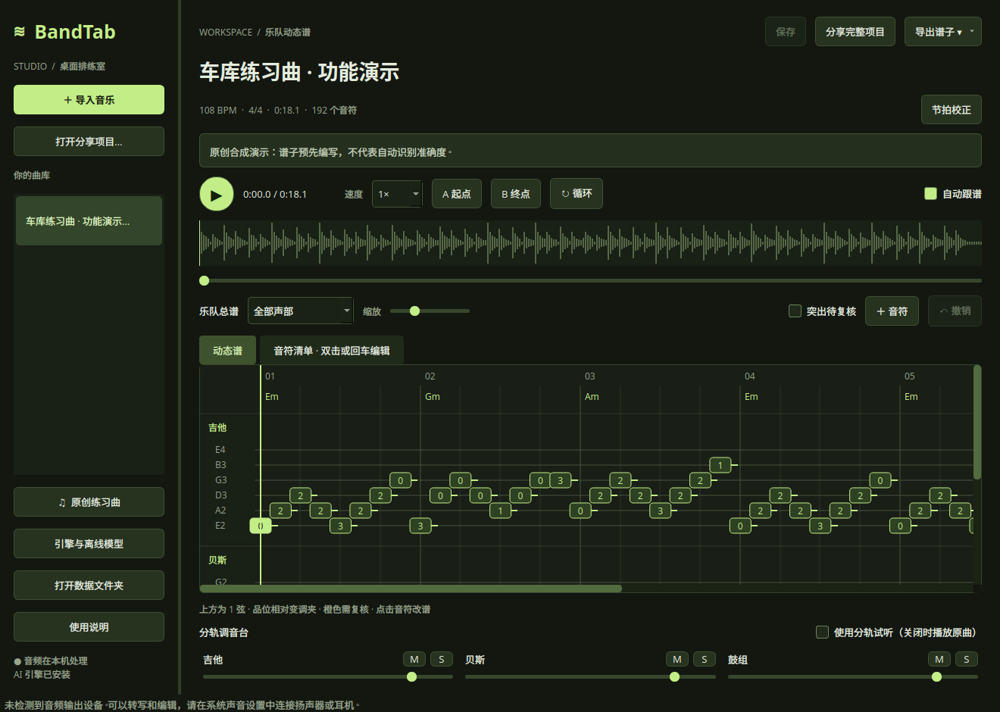

# BandTab Studio — 音乐转动态乐队谱

把本地音乐转成可编辑的乐队谱草稿，边听边跟谱，校正后与队友一起排练。中文桌面界面，支持 AI 分轨、吉他/贝斯弦品、慢放循环和完整项目分享。

## 先选择你的电脑系统

| 我的电脑 | 从这里开始 | 当前状态 |
| --- | --- | --- |
| Windows x64 | [Windows 下载与运行](#windows) | 安装版、便携版已构建并通过 Windows 自动验证 |
| macOS（Apple Silicon / Intel） | [macOS 下载与运行](#macos) | 安装包尚未提供，可尝试源码运行；待实机验证 |
| Linux x86_64 | [Linux 下载与运行](#linux) | 已构建并自检通过便携包，兼容条件见下文 |

**下载入口：[GitHub Releases](https://github.com/Jason-TongR/Muscic-change-to-Band-Tab/releases)。** 在对应版本的 **Assets（附件）** 中选择系统匹配的文件。只有已经上传的附件才可下载；某个平台没有附件，就表示该平台暂未提供成品包。

完整发行包自带运行库和模型，不需要安装 Python。GitHub 自动显示的 **Source code (zip / tar.gz)** 是源码，不是可直接运行的软件。

以下平台状态截至 **2026-11-08**。首次使用也可以先读[转谱步骤](#第一次转谱)、[分享方式](#分享与导出)和[识别限制](#识别能力与限制)。

### Windows

**系统要求：** Windows 10 1809 及以上或 Windows 11，x64 电脑。安装版与便携版已在 Windows 构建机通过界面、中文路径、项目导入导出、离线 AI 转谱、安装、重复安装及卸载验证。

在 Releases 中选择其中一种：

| 附件 | 启动方法 |
| --- | --- |
| `BandTabStudio-Windows-x64-Setup.exe` | 运行安装程序，安装后打开 BandTab Studio |
| `BandTabStudio-Windows-x64-Portable.zip` | 完整解压，运行文件夹中的 `BandTabStudio.exe`，保留同目录其他文件 |

一般用户推荐安装版，支持中文安装向导、开始菜单快捷方式和卸载。安装无需管理员权限，曲库保存在 `%LOCALAPPDATA%\BandTab Studio\`，卸载保留曲库。便携版也需要完整解压，不能在压缩包内直接启动。

安装版和便携版包含 CPU AI 引擎及模型，不需要 Python。详细的安装、数据备份和构建方法见 [Windows 使用说明](docs/WINDOWS.md)。

**Release 尚未上传时：** 已登录 GitHub 的用户可到 [Windows 构建记录](https://github.com/Jason-TongR/Muscic-change-to-Band-Tab/actions/workflows/windows-build.yml)，选择最新成功记录，下载页面底部的 `BandTabStudio-Windows-x64`，解压外层 ZIP 后取得上述两个文件。Actions 附件只保留 14 天；对外长期分发请使用 Release。

<details>
<summary>暂时没有安装包？从源码运行（需要 Python 3.11）</summary>

从仓库的 **Code → Download ZIP** 获取源码并解压。安装 Python 3.11，在包含 `desktop.py` 的项目根目录打开 PowerShell，执行：

```powershell
py -3.11 scripts/setup_desktop.py
.\.venv-desktop\Scripts\python.exe desktop.py
```

首次安装依赖需要联网及数 GB 可用磁盘。以后可以双击 `scripts/start_desktop.bat` 启动。

</details>

### macOS

**目前状态：** 已准备 Apple Silicon 和 Intel 两种构建配置，尚未生成或验证 Mac 成品包。构建目标为 macOS 13 及以上。

在「关于本机」查看处理器，提供成品后选择对应附件：

| 电脑类型 | 附件名称中的标记 |
| --- | --- |
| Apple Silicon（M 系列芯片） | `Darwin-arm64` |
| Intel 处理器 | `Darwin-x86_64` |

下载 `.dmg`，打开后把 `BandTabStudio.app` 复制到「应用程序」；或解压对应 `.zip` 获得应用。是否签名、公证以该版本发布说明为准；未签名预览版可能被系统拦截。

<details>
<summary>暂时没有安装包？从源码运行（需要 Python 3.11）</summary>

从仓库的 **Code → Download ZIP** 获取源码并解压。安装 Python 3.11，在包含 `desktop.py` 的项目根目录打开终端，执行：

```bash
python3.11 scripts/setup_desktop.py
.venv-desktop/bin/python desktop.py
```

首次安装依赖需要联网及数 GB 可用磁盘。以后可运行 `bash scripts/start_desktop.sh` 启动。

</details>

### Linux

**目前状态：** 已构建并自检通过 `BandTabStudio-Linux-x86_64-glibc2.43.tar.gz`。是否已上传，请查看 [Releases 附件](https://github.com/Jason-TongR/Muscic-change-to-Band-Tab/releases)。

这个包在 Ubuntu 26.04 / x86_64 / glibc 2.43 环境构建，需要兼容的系统图形和音频库；较旧的发行版可能无法启动。请按 Release 标注的兼容条件选包，不能把它当作任意 Linux 都能运行的程序。

1. 下载对应 `.tar.gz`，解压整个压缩包。
2. 打开解压后的 `BandTabStudio` 文件夹，运行 `BandTabStudio`，或在该文件夹的终端执行：

```bash
./启动BandTab.sh
```

3. 软件打开后，点击「原创练习曲」体验功能。

当前包约 489 MiB，解压后约 1.4 GiB，曲库与计算缓存会继续占用磁盘。**请保留完整目录，不要只复制可执行文件。**

<details>
<summary>从源码运行（需要 Python 3.11）</summary>

从仓库的 **Code → Download ZIP** 获取源码并解压。安装 Python 3.11，在包含 `desktop.py` 的项目根目录打开终端，执行：

```bash
python3.11 scripts/setup_desktop.py
.venv-desktop/bin/python desktop.py
```

首次安装依赖需要联网及数 GB 可用磁盘。以后可运行 `bash scripts/start_desktop.sh` 启动。源码运行同样需要兼容的系统图形和音频库。

</details>

## 界面预览



*图中是预先编写音符的原创合成演示，用来展示功能，不代表自动识别准确率。*

## 第一次转谱

1. **准备音频。** 支持 WAV、MP3、FLAC、M4A、AAC、OGG、OPUS、AIFF；单个文件最多 200 MB，时长 0.3 秒至 15 分钟。初次建议先用 30–60 秒片段判断效果。
2. **导入。** 点击「导入音乐」，或者把音频拖进主窗口。
3. **选模式。** 按下表选择；整首歌曲通常选「完整乐队」。
4. **核对设置。** 选择实际调弦、变调夹和拍号。已知 BPM 就填写，不知道可保留自动估计。设备先选 CPU。
5. **开始转写。** 窗口会显示进度，可以取消。CPU 分轨可能远慢于歌曲时长，首次运行还要准备计算缓存。
6. **校正结果。** 先在「节拍校正」检查 BPM 和首小节重拍，再逐句检查音高、起止时间与指法。
7. **保存并排练。** 使用慢放、A/B 循环和分轨试听；完成后保存，按需要分享或导出。

| 你手里的音频 | 选择模式 | 会得到什么 |
| --- | --- | --- |
| 包含人声、吉他、贝斯、鼓等的完整混音 | 完整乐队 | 分离吉他、贝斯、鼓、钢琴、人声、其他伴奏六轨，再生成可用声部的谱草稿；其他伴奏仅供试听 |
| 已经分离好的吉他、贝斯或键盘等音轨 | 单乐器多音 | 转写这一条音轨，可识别同时发声的多个音；不会再分离乐器 |
| 干净的单音旋律录音 | 基础单音 | 估计单音旋律，不分轨，不识别和弦里的多个音；音符全部标为待复核 |

已有独立乐器音轨时，优先直接使用它，可以减少分轨带来的误差。

## 跟谱、改谱怎么操作

| 要做的事 | 操作 |
| --- | --- |
| 边听边看谱 | 点击播放，勾选「自动跟谱」；点击波形或谱面空白处跳转 |
| 反复练一句 | 在需要的位置分别设置「A 起点」「B 终点」，再开启「循环」 |
| 放慢速度 | 在「速度」选择 0.5×–1.25×；保调效果取决于系统多媒体后端 |
| 只听某个乐器 | 启用「使用分轨试听」，按该声部的 S；M 是静音，下方滑条调音量 |
| 修改一个音符 | 点击谱上的音符，或在「音符清单」双击/回车；可改音高、时间、力度和弦/品 |
| 增加、删除或撤销 | 使用「＋音符」、编辑窗口中的「删除音符」或「撤销」 |
| 保存 | 点击「保存」；也支持 Ctrl+S。Ctrl+O 导入音频，Ctrl+Z 撤销 |

六线谱最上方是 1 弦；品位相对于变调夹计算。橙色表示待复核，`?` 表示没有分配出可用指法。改谱只修改音符数据，不会改变录音里实际听到的声音。

## 分享与导出

### 发给队友一起排练

需要分别准备**软件**和**歌曲项目**：

1. 队友先安装或解压适合自己系统的完整 BandTab 桌面版。
2. 你在软件里点击「分享完整项目」，得到一个 `.bandtab` 文件。
3. 把这个文件发给队友，对方点击「打开分享项目…」导入。

`.bandtab` 包含谱子、原曲和分离音轨；对方可以直接跟谱、试听和编辑，不需要重新识别。**它不是安装包，不能代替软件。**

如果 Release 附带 `practice-demo.bandtab`，可以下载后通过「打开分享项目…」导入，测试这套分享流程。

### 交给其他音乐软件继续处理

| 格式 | 适合用途 | 包含音频吗 |
| --- | --- | --- |
| `.bandtab` 完整项目 | 在 BandTab 中排练、继续编辑和迁移 | 是 |
| MIDI（`.mid`） | 把各声部音符导入 DAW 等软件 | 否 |
| MusicXML（`.musicxml`） | 导入支持 MusicXML 的制谱软件，继续整理排版 | 否 |
| 文本 TAB（`.txt`） | 查看按小节排列的文字六线谱 | 否 |

MIDI 保留音符实际起止时间，使用固定 120 BPM 编码，不包含原曲变速节拍表。MusicXML 和文本谱按十六分音符网格整理；三连音、弱起和特殊奏法需要后期处理。导出功能不保证其他软件排版与本软件一致。

旧网页版项目也可以迁移：从桌面版打开原项目目录中的 `project.json`，其引用的音频必须仍在原位置。软件会复制到桌面曲库；单独一个 JSON 文件不包含音频。

## 识别能力与限制

软件适合帮助你开始扒谱和逐句排练，尚不能保证把任意歌曲自动还原成准确总谱，也没有经过真实歌曲标注集验证的准确率百分比。

- **吉他 / 贝斯：** 估计音高、时值并分配弦品。支持吉他标准调弦、Drop D、降半音及变调夹；分配的指法不一定是原演奏者使用的指法。
- **复杂吉他录音：** 失真、叠录、闷音、推弦、滑音容易产生错误；六轨分离不能保证拆开主音吉他与节奏吉他。
- **鼓：** 仅提供底鼓、军鼓、踩镲三类参考鼓点，不是完整鼓组转写。
- **节拍 / 和弦：** BPM 可能出现倍速或半速，需要核对重拍和拍号；当前拍号以四分音符为单位，6/4 不等于 6/8。和弦提示只覆盖大、小三和弦。
- **演示曲：** 音频和谱子是预先合成、编写的，仅用于体验功能。

## 离线使用、数据和常见问题

**是否需要联网？** 完整便携包包含模型，首次使用会将模型复制到可写缓存。源码环境首次准备依赖或缺失的模型时需要联网；准备好后在本地识别，不把音频上传到云端。左下「引擎与离线模型」可查看状态并准备模型。

**歌曲保存在哪里？** 点击「打开数据文件夹」最方便。默认路径如下，`projects/` 是曲库，`models/` 是模型，`cache/` 是计算缓存：

| 系统 | 桌面版默认数据目录 |
| --- | --- |
| Windows | `%LOCALAPPDATA%\BandTab Studio\` |
| macOS | `~/Library/Application Support/BandTab Studio/` |
| Linux | `~/.local/share/bandtab-studio/`，遵循 XDG_DATA_HOME |

可以用环境变量 `BANDTAB_HOME` 改变数据目录。桌面版与旧网页版的 `data/` 曲库分开保存；升级应用不需要覆盖曲库，迁移歌曲优先使用 `.bandtab`。

**一直处理、是不是卡住了？** 首次计算缓存和 CPU 分轨都可能较慢。先用短片段验证；取消任务可能要等待当前推理片段结束。当前没有断点续算，取消后需重新开始。

**没有声音？** 先检查系统输出设备，再确认分轨的静音、独奏和音量设置。提示「未检测到音频输出设备」时，需要先让系统识别扬声器或耳机。

**提示缺少 AI 引擎？** 普通使用者应使用完整发行包；源码使用者按上方对应系统的步骤安装。只安装基础依赖无法运行完整乐队模式。

## 开发与构建

先按上方对应系统的步骤创建 `.venv-desktop` 环境。所有命令均在项目根目录执行。源码、文档和构建配置保存在 Git 仓库；生成的软件包通过 Releases 分发。

| 操作 | Windows PowerShell | Linux / macOS 终端 |
| --- | --- | --- |
| 运行桌面版 | `.\.venv-desktop\Scripts\python.exe desktop.py` | `.venv-desktop/bin/python desktop.py` |
| 构建发行包 | 双击 `build-windows.cmd` | `.venv-desktop/bin/python scripts/build_desktop.py --archive` |
| 运行测试 | `.\.venv-desktop\Scripts\python.exe -m unittest discover -s tests -v` | `.venv-desktop/bin/python -m unittest discover -s tests -v` |

打包需在目标系统分别执行。程序目录生成在 `dist/`，发布用的压缩包等产物生成在 `release/`。Windows 全套构建需要 Python 3.11 x64 和 Inno Setup 6.5 及以上，会自动测试便携运行、安装、模型转写、重复安装与卸载，详见 [Windows 构建说明](docs/WINDOWS.md#开发者一键构建)。Mac 签名、公证和其他平台细节见[桌面版详细说明](docs/DESKTOP.md#三个平台的打包)。

仓库提供 [Windows 专用构建](.github/workflows/windows-build.yml)和[四平台手动构建](.github/workflows/desktop-build.yml)。产物保存在 Actions artifacts；不会自动创建或发布 GitHub Release。维护者填写 About 和选择发布附件时，请按[发布指南](docs/PUBLISHING.md)操作。

想继续使用浏览器版或命令行批量转写，请看[旧网页版与命令行说明](docs/WEB.md)。`scripts/start.sh` 是网页版入口，`scripts/start_desktop.sh` 是桌面版入口。

### 验证范围

截至 2026-11-08，Linux 源码环境的 36 项自动测试已通过；Linux 独立程序已通过界面渲染、项目包导入导出、识别进程和真实 AI 分离转谱检查。

Windows x64 构建机也已通过 36 项测试，并使用打包后的 EXE 检查原生窗口、中文路径、离线六轨 AI 转谱、安装、重复安装和卸载保留曲库。每个 Windows 成品包附带 `Windows-validation.json` 与构建信息。

Linux 界面使用离屏渲染检查；Windows 使用原生 Windows 窗口组件。实体扬声器、耳机与各种驱动尚未全面测试，macOS 安装运行仍待验证。这些检查证明功能流程可运行，不代表真实歌曲识别准确率。

程序支持 `--self-test` 自检，附加 `--ai` 会实际运行模型。使用上表中的环境 Python 执行 `desktop.py --self-test --ai`；打包后也可以让可执行程序带上同样参数运行。

## 更多文档

- [桌面版详细说明](docs/DESKTOP.md)：离线模型、数据、打包与平台限制。
- [旧网页版与命令行](docs/WEB.md)：原有浏览器入口、批量转谱和技术细节。
- [GitHub 发布指南](docs/PUBLISHING.md)：维护者填写 About、创建 Release 和选择附件的方法。
- [第三方组件说明](packaging/THIRD_PARTY.md)：随软件分发的依赖与许可证。
